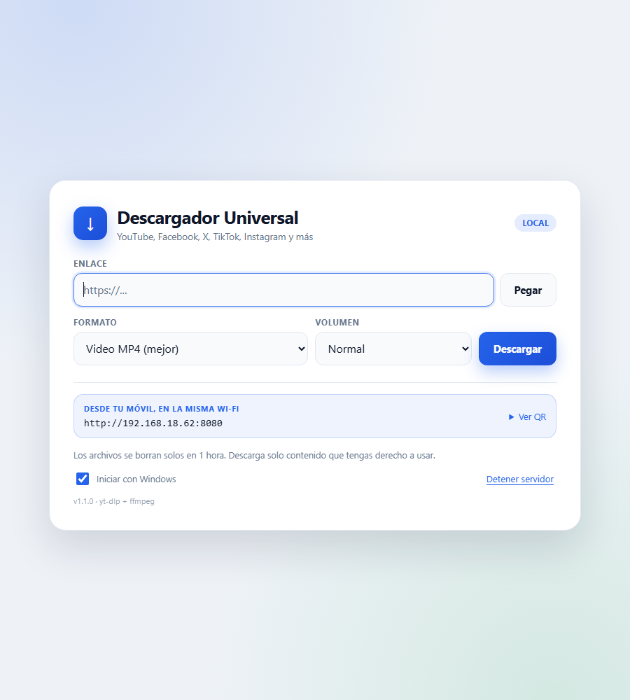
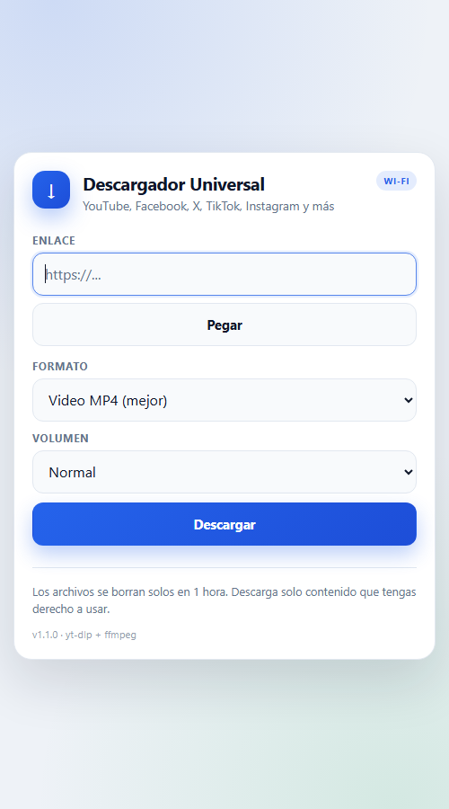

# Descargador Universal

Barra flotante para **Windows, Ubuntu/Debian y macOS** que descarga video o audio de YouTube, Facebook, X (Twitter), Instagram, TikTok, Twitch, Vimeo, SoundCloud y unos **1800 sitios** usando [yt-dlp](https://github.com/yt-dlp/yt-dlp) y ffmpeg.


## Que hace

- Barra mini de **480x48** pegada arriba de la barra de tareas. Pegas el enlace, pulsas Enter y descarga.
- Elige calidad: mejor disponible, 1080p, 720p, 480p o solo audio MP3 con caratula.
- **Siempre MP4**: al terminar remuxea o recodifica a MP4 con audio AAC para que se abra en cualquier reproductor.
- **Boton A+**: sube el volumen del audio (+50%, +100% o +200%) con limitador para evitar distorsion.
- Descarga playlists completas, subtitulos y usa cookies del navegador para sitios que piden sesion.
- **Se actualiza solo**: comprueba yt-dlp una vez al dia y lo reemplaza sin tocar Python. Si una red cambia y bloquea las descargas, la actualizacion lo arregla.
- Motor JavaScript **QuickJS incluido**: YouTube funciona aunque no tengas Node.js instalado.
- **Web local**: la misma app en el navegador, con acceso desde el movil en la misma Wi-Fi y codigo QR.
- Se adapta al tema claro u oscuro de Windows.
- Todo se guarda en una carpeta del usuario; el instalador de Windows no pide administrador.

## Instalar

### Windows

1. Entra en [Releases](../../releases) y descarga `DescargadorUniversal_Setup_1.1.0.exe`.
2. Ejecutalo. Se instala en `%LOCALAPPDATA%\Programs\Descargador Universal` (por usuario, sin admin).
3. Abre **Descargador Universal** desde el escritorio o el menu Inicio.

> El instalador no esta firmado. Si Windows SmartScreen muestra un aviso, pulsa **Mas informacion > Ejecutar de todas formas**.

### Ubuntu / Debian

Descarga `descargador_1.1.0_amd64.deb` desde [Releases](../../releases) y ejecuta:

```bash
sudo apt install ./descargador_1.1.0_amd64.deb
descargador
```

Instala ffmpeg como dependencia. Si usas `dpkg -i`, completa con `sudo apt -f install`.
El paquete esta probado en Ubuntu 22.04 (glibc 2.35, compatible con 24.04).

### macOS

No hay binario firmado ni notarizado. Para compilarlo en un Mac:

```bash
bash packaging/macos/build.sh
```

Genera `instaladores/DescargadorUniversal-1.1.0-macOS.dmg`. Como no esta firmado, al abrirlo hay que hacer **clic derecho > Abrir** la primera vez.

## Web local (PC + movil)

La misma app en el navegador, sin instalar nada mas. Mientras la PC este encendida y el servidor este activo:

1. Doble clic en **Descargador Web** (escritorio) o en `Iniciar web.bat`.
2. En el PC: <http://localhost:8080>
3. En el movil: misma Wi-Fi. La pagina muestra la direccion y un QR para escanear.

Tiene lo mismo que la app: MP4 o MP3, calidad, ganancia A+, progreso y descarga directa. Los archivos se borran solos en 1 hora.

> La web local se ejecuta desde el repositorio y necesita Python 3.10 o superior. El instalador de Windows incluye solo la barra de escritorio.

**GitHub no aloja la web ni ejecuta las descargas**: solo guarda el codigo. Cada persona la corre en su propia PC.

- **Iniciar con Windows** deja el servidor activo al encender la PC.
- Es solo para tu red Wi-Fi. Para un link publico hace falta un tunel con clave (Cloudflare Tunnel o Tailscale Funnel) o un VPS.
- **Vercel no sirve para esto**: sus funciones no pueden ejecutar yt-dlp/ffmpeg, tienen limite de tiempo y de respuesta, y las IPs de datacenter estan bloqueadas por YouTube.





### Link publico (opcional)

**Tailscale Funnel (link fijo, recomendado)**

1. Instala Tailscale y inicia sesion en la PC.
2. Ejecuta:

   ```bash
   tailscale funnel --bg 8080
   ```

3. La URL fija es `https://<maquina>.<tu-tailnet>.ts.net`.
4. La web pide el usuario y la clave configurados en `web.usuario` y `web.clave`.

La URL no cambia mientras no cambies el nombre de la maquina o el tailnet. Requiere la PC encendida.
Para apagarlo: `tailscale funnel --https=443 off`.

**Cloudflare Tunnel (link temporal)**

1. Ejecuta `Iniciar tunel.bat` (o el acceso directo **Tunel Cloudflare**).
2. Copia la URL `https://....trycloudflare.com` que aparece en la consola.
3. La web pide el usuario y la clave configurados (por defecto `descargador`, se cambia con `--usuario` y `web.clave`).

La URL cambia cada vez que reinicias el tunel.

> Cloudflare necesita `cloudflared` en `bin/cloudflared.exe` (descarga oficial) y una clave de una linea en `web.clave`. La clave tambien se usa en el PC.

## Como lo usa otra persona (cada uno en su PC)

El link de Tailscale de una persona solo funciona mientras **su** PC esta encendida. Para que otra persona tenga su propia web:

### 1. Descargar el proyecto

```bash
git clone https://github.com/edumilla1994/descargador-universal.git
cd descargador-universal
```

O desde GitHub: **Code > Download ZIP** y descomprimir.

### 2. Instalar Python y dependencias

Requiere Python 3.10 o superior.

```bash
python -m pip install -r requirements.txt
python scripts/instalar_dependencias.py
```

El segundo comando descarga yt-dlp y ffmpeg en Windows. En Linux/macOS instala ffmpeg con `sudo apt install ffmpeg` o `brew install ffmpeg`.

### 3. Poner su propio usuario y clave

Crear dos archivos de una linea en la carpeta del proyecto:

- `web.usuario` con su usuario, por ejemplo `eduardo`
- `web.clave` con una clave larga

Tambien se puede pasar `--usuario` y `--clave` al ejecutar.

### 4. Abrir la web

```bash
python web.py --lan --abrir
```

En Windows tambien sirve `Iniciar web.bat`.

### 5. Link publico con su propia cuenta de Tailscale

1. Descargar Tailscale desde <https://tailscale.com/download> e instalarlo.
2. Iniciar sesion con Google, Microsoft, GitHub o email. La cuenta es gratis.
3. En una terminal:

   ```powershell
   & "C:\Program Files\Tailscale\tailscale.exe" funnel --bg 8080
   ```

   En Linux/macOS:

   ```bash
   sudo tailscale funnel --bg 8080
   ```

4. La primera vez Tailscale puede pedir activar Funnel en el panel; seguir el enlace que muestra.
5. Su link sera `https://<nombre-de-su-pc>.<su-tailnet>.ts.net`. Se consulta con:

   ```bash
   tailscale funnel status
   ```

**Cada persona necesita su propia cuenta de Tailscale.** No compartan la misma cuenta ni el link de otro: el link usa la PC y el internet de su dueno.

> Si quieres que otra persona use **tu** instancia, pasale tu link y tu usuario/clave. Ten en cuenta que consumira tu PC y tu conexion. No publiques el link abiertamente.

### Si solo quiere la app de escritorio

Descarga el instalador desde [Releases](../../releases). No necesita Python, Tailscale ni configurar nada.

## Uso

1. Pega el enlace en la barra y pulsa **Enter** (o la flecha azul).
2. La linea de abajo marca el progreso. Al terminar, el boton parpadea en verde.
3. El boton **A+** cambia el volumen: Normal, +50%, +100% o +200%. Se queda guardado.
4. El **engranaje** o el **clic derecho** abren:
   - Calidad y cookies.
   - Carpeta de descargas.
   - Descargar playlist completa.
   - Modo completo (con texto de estado).
   - Buscar actualizaciones.
   - Iniciar con Windows / al encender.
   - Ver registro y salir.

La barra se puede arrastrar. Si la cierras, se vuelve a abrir desde el acceso directo.

### Carpetas

| Que | Windows | Linux | macOS |
|---|---|---|---|
| Descargas | `%USERPROFILE%\Downloads\Descargador` | `~/Downloads/Descargador` | `~/Downloads/Descargador` |
| Configuracion | `%APPDATA%\Descargador` | `~/.config/descargador` | `~/Library/Application Support/Descargador` |
| yt-dlp actualizado | `%LOCALAPPDATA%\Descargador\bin` | `~/.local/share/descargador/bin` | `~/Library/Application Support/Descargador/bin` |

## Actualizaciones

yt-dlp cambia cada pocas semanas porque las redes cambian sus bloqueos. La app:

- Comprueba la ultima version al arrancar (como maximo una vez al dia).
- La descarga e instala sola si esta activada la opcion.
- Si la desactivas, muestra un aviso con **Actualizar ahora / Despues**.
- Tambien puedes forzarla desde el menu: **Buscar actualizaciones**.

La actualizacion se guarda en la carpeta del usuario, no en la del programa, asi que funciona aunque el programa este instalado en `/opt` o en `Program Files`.

## Cookies (sitios con sesion)

Facebook privado, Instagram, X con contenido restringido y algunos videos de YouTube con edad necesitan las cookies de tu navegador.

- En el menu elige **Cookies > Firefox** (es el mas fiable).
- Chrome y Edge modernos cifran las cookies con App-Bound Encryption y yt-dlp puede fallar al leerlas.
- Si falla, exporta un `cookies.txt` con la extension **Get cookies.txt LOCALLY** y usa la consola:

```bash
python descargar.py --cookies "C:\ruta\cookies.txt" "https://..."
```

## Limites

- **Si**: contenido publico o con tu cuenta, playlists, directos terminados, audio, subtitulos, y sitios sin DRM.
- **No**: Netflix, Disney+, Prime Video, Spotify y similares (DRM). Tampoco contenido privado de otras personas.
- La responsabilidad del uso y de los derechos de autor es de quien descarga.

## Desarrollo

Requisitos: Python 3.10 o superior, y ffmpeg (en Windows lo descarga el script).

```bash
python -m pip install -r requirements-dev.txt
python scripts/instalar_dependencias.py
```

Ejecutar:

```bash
python Barra.pyw          # barra mini
python Descargar.pyw      # ventana completa (solo desde el codigo fuente)
python descargar.py "https://youtu.be/XXXX"
python descargar.py --ganancia 2.0 "https://youtu.be/XXXX"
python descargar.py --diagnostico
python descargar.py --actualizar
python web.py --lan --abrir   # web local para PC y movil
python web.py --lan --usuario eduardo --clave "MiClave"  # con acceso propio
```

Tests:

```bash
python -m pytest
```

Los tests cubren la construccion de comandos, cookies, playlists, comparacion de versiones, QuickJS sin Node, MP4 con audio AAC, ganancia, la web local (rutas, QR y clave basica) y un smoke test de la interfaz. El test de empaquetado se ejecuta solo si existe `dist/Descargador/Descargador.exe`.

### Compilar

**Windows** (requiere [Inno Setup 6](https://jrsoftware.org/isdl.php)):

```powershell
powershell -ExecutionPolicy Bypass -File packaging\windows\build.ps1
```

**Ubuntu/Debian** (requiere Docker):

```bash
bash packaging/linux/build.sh
```

**macOS** (requiere macOS y Homebrew):

```bash
bash packaging/macos/build.sh
```

## Estructura

```
Barra.pyw                  barra mini (interfaz principal)
Descargar.pyw              ventana completa con registro
descargar.py               motor: comandos, descarga, MP4, ganancia y actualizacion
web.py                     web local para PC y movil
templates/                 HTML de la web
static/                    CSS y JavaScript de la web
Iniciar web.bat            lanzador de la web local
Iniciar tunel.bat          link publico con Cloudflare
assets/                    iconos ico, png, icns
docs/                      capturas y checklist de pruebas
packaging/windows/         instalador Inno Setup y script de build
packaging/linux/           .deb y build con Docker
packaging/macos/           .app y .dmg
scripts/                   lanzadores y descarga de dependencias
tests/                     pruebas automaticas
```

## Estado de las pruebas

| Plataforma | Estado |
|---|---|
| Windows 11 (instalador, descarga YouTube/Facebook/TikTok/X) | Probado |
| Ubuntu 22.04 (.deb, descarga YouTube, GUI con Xvfb) | Probado |
| Web local (PC + movil, MP4, ganancia, QR) | Probado |
| Tailscale Funnel (link fijo, usuario/clave) | Probado |
| macOS | Script listo, sin probar (requiere un Mac) |

Checklist manual completo en [docs/QA.md](docs/QA.md).

## Licencia

MIT. Ver [LICENSE](LICENSE).
